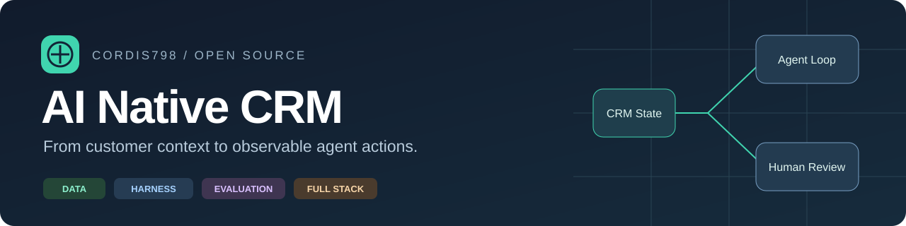
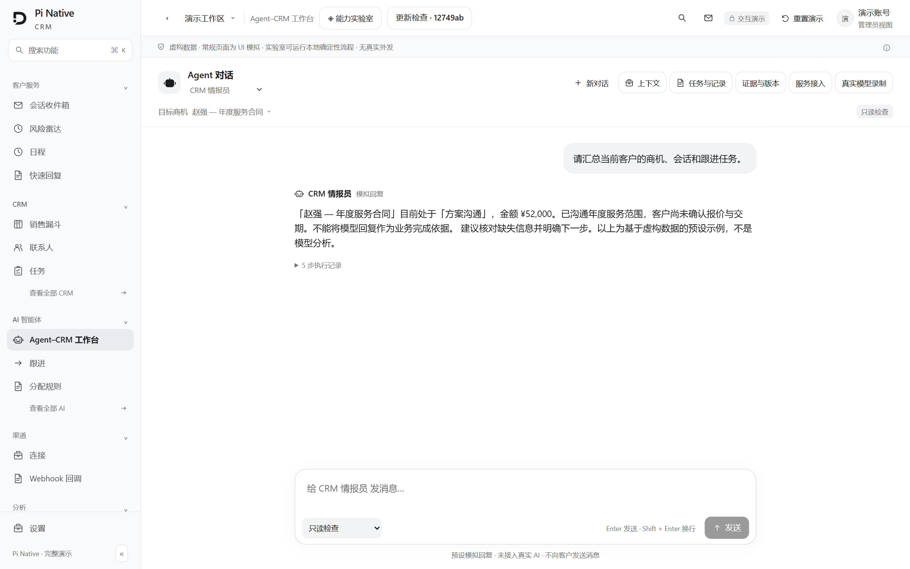
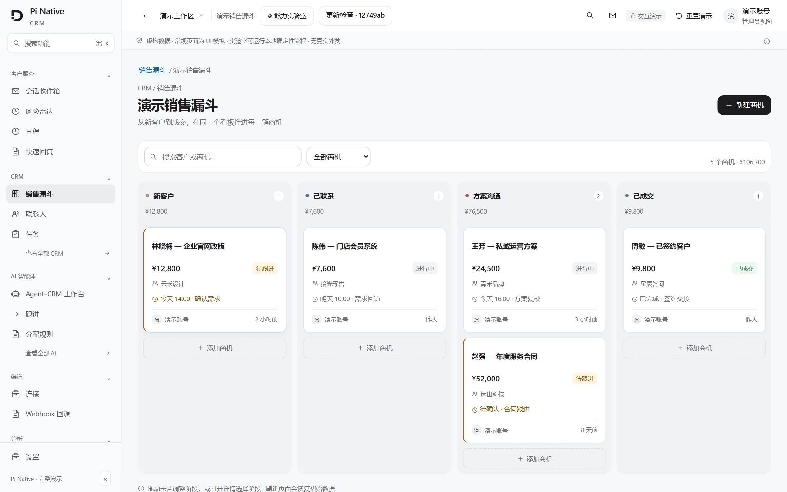
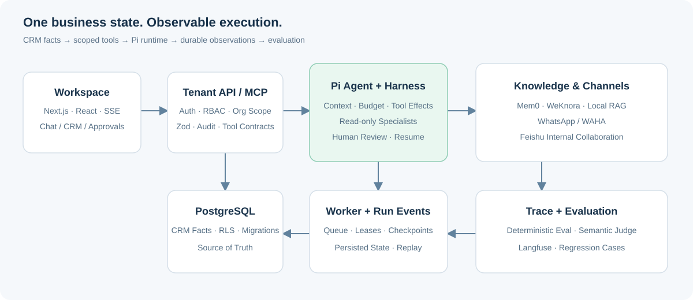

<p align="center">
  
</p>

<h1 align="center">AI Native CRM</h1>

<p align="center"><strong>让客户事实，变成可追踪的业务行动。</strong></p>
<p align="center">面向客户经营与销售协作的个人全栈项目：CRM 数据、Agent 执行、人工决策和评测反馈在同一套系统中协作。</p>

<p align="center">
  <a href="https://cordis798.github.io/ai-native-crm/#/app/ai/workbench"><strong>▶ 在线演示</strong></a> ·
  <a href="#产品预览">产品预览</a> ·
  <a href="#agent-工程实现">Agent 工程</a> ·
  <a href="#全栈交付">全栈交付</a> ·
  <a href="#本地运行">本地运行</a>
</p>

<p align="center"></p>

## 为什么做这个项目

销售跟进需要同时理解客户、会话、商机和公司知识。信息分散时，生成一段建议很容易；让建议基于当前事实、经过合适的权限检查并留下可复核的动作记录，才是系统要解决的问题。

本项目以跨境客户经营为场景：**WhatsApp 承接客户沟通，飞书承接内部同事协作，CRM 保存业务事实**。用户从工作台提交任务，Agent 检索知识与记忆、调用 CRM 工具；需要人工决策的动作进入相应流程，执行结果以 Run、事件、观察和评测留存。

## 产品预览

**[打开在线演示 →](https://cordis798.github.io/ai-native-crm/#/app/ai/workbench)**

演示使用合成客户数据和历史模型录制，独立于真实后端。可以浏览工作台、客户、商机和能力实验室；页面内的操作用于演示交互，不会发送真实消息或调用付费模型。

<a href="https://cordis798.github.io/ai-native-crm/#/app/ai/workbench"></a>

<details>
<summary><strong>查看 CRM 商机工作台</strong></summary>



</details>

## Agent 工程实现

### ① 数据：让模型有可信、可调用的业务上下文

- **CRM 事实与工具契约**：联系人、会话、商机和跟进状态由 PostgreSQL 保存，经 MCP 工具向 Agent 暴露；工具执行沿用组织作用域和业务权限。[MCP 入口](lib/mcp/server.ts) · [工具目录](lib/mcp/tools/catalogo)
- **知识检索与来源核验**：本地 RAG 与 WeKnora 接入保留来源、页面版本及引用，授权知识进入上下文；检索结果不能替代业务动作授权。[WeKnora 适配](lib/ai/integrations/weknora.ts) · [上下文构建](lib/agent-engine/agent/context-builder.ts)
- **人工确认的客户记忆**：SQL 是客户事实源，Mem0 是可选的检索投影与排序层；同步、未知写入、删除和清理均保留状态。[Mem0 适配](lib/ai/integrations/mem0.ts)

### ② Harness：让任务在权限、状态和预算约束下推进

- **Pi 运行时与产品解耦**：运行时适配层封装 Pi 事件、模型调用和工具交互，产品层通过自有契约消费执行结果。[运行时实现](lib/agent-runtime/pi/runtime.ts)
- **按副作用管理工具**：区分读取、具备补偿实现的写入、外部动作和不可逆动作；未登记工具拒绝执行，业务动作保留字段差异、观察和审计。[副作用分类](lib/ai/agents/tool-effects.ts) · [可逆写入](lib/ai/agents/reversible-lead-update.ts)
- **持久化执行与恢复**：独立 Worker 消费 SQL 作业队列，Run、事件和检查点保存执行进度；失去作业租约时停止发起副作用。[队列](lib/agent-engine/queue/queue.ts) · [任务入口](lib/ai/agents/workbench-start-job.ts) · [租约校验](lib/ai/agents/workbench-job-lease.ts)
- **受限多 Agent 协作**：专职 Agent 承担只读调查，父运行汇总证据与冲突并负责业务动作；父子 Run 分别留存上下文与结果。[协作编排](lib/ai/agents/workbench-collaboration.ts) · [证据核验](lib/ai/agents/collaboration-runtime.ts)
- **跨运行 Mission**：保存目标、验收条件、方向版本和累计预算；负责人调整方向时，版本检查与任务锁约束旧方向写入。[方向保护](lib/ai/agents/mission-direction-fence.ts) · [任务预算](lib/ai/agents/mission-budget.ts)

### ③ Eval：把执行结果变成可检查的反馈

- **确定性检查与语义评审分工**：确定性 Eval 核对策略、证据与动作链；语义 Judge 辅助判断自由文本目标，保存评分依据和需要人工复核的结论。[Mission Eval](lib/ai/evals/evaluate-mission.ts) · [评测实现](lib/ai/evals)
- **Run → Trace → 回归样例**：Langfuse 接收经过边界约束的用量与评分投影，投递队列负责去重和重试；失败样例用于人工修正知识、Skill 或流程。[Langfuse 适配](lib/ai/integrations/langfuse.ts) · [回归测试](tests/unit)

## 系统架构



| 层次 | 主要职责 | 源码入口 |
| --- | --- | --- |
| 产品与交互 | 客户、会话、商机、Agent 工作台、审批与执行回放 | [app/app](app/app) · [components](components) |
| API 与权限 | 会话鉴权、RBAC、输入校验、组织作用域、审计 | [app/api/v1](app/api/v1) · [lib/auth](lib/auth) |
| Agent 执行 | Pi 适配、上下文、工具策略、协作、Mission | [lib/agent-runtime](lib/agent-runtime) · [lib/ai/agents](lib/ai/agents) |
| 数据与异步 | PostgreSQL、RLS、SQL 队列、独立 Worker | [supabase](supabase) · [workers](workers) |
| 知识与观测 | RAG、Mem0、WeKnora、Langfuse、Eval | [lib/ai/integrations](lib/ai/integrations) |

## 全栈交付

| 工程面 | 实现与取舍 | 查看实现 |
| --- | --- | --- |
| 前端 | Next.js App Router、React、TypeScript；以 SSE 与持久事件展示执行过程 | [工作台组件](app/app/ai/workbench/_components/AgentCrmWorkbench.tsx) |
| 后端 | Route Handlers 与 MCP 共用业务能力；通过组织作用域、RBAC、Zod 和审计约束入口 | [API 目录](app/api/v1) · [响应封装](lib/api/wrappers.ts) |
| 数据库 | Supabase Auth / PostgreSQL / RLS；迁移、baseline 和清单共同管理数据库变化 | [数据库基线](supabase/baseline.sql) · [迁移清单](supabase/migrations/MANIFEST.md) |
| 异步处理 | Web、Agent Worker 和调度分开运行，避免长任务绑定请求生命周期 | [Worker](workers/agent-worker/main.ts) · [调度入口](scripts/dev-crons.ts) |
| 部署 | Docker 多阶段构建；应用、Worker、调度器独立服务，按部署配置接入数据库与渠道 | [Dockerfile](Dockerfile) · [Compose](docker-compose.prod.yml) |
| 验证 | Vitest 单元测试、数据库不变量、Playwright 用户流程和安装脚本检查 | [测试目录](tests) · [CI](.github/workflows/ci.yml) |

## 本地运行

### 先体验交互演示

只需要 Node.js 22+，无需安装项目依赖：

```bash
git clone https://github.com/Cordis798/ai-native-crm.git
cd ai-native-crm
node scripts/serve-agent-demo.mjs
```

打开 **http://127.0.0.1:3008/#/app/ai/workbench**。

### 启动完整应用

需要 Node.js 22+、项目指定的 pnpm、Bash、PostgreSQL 客户端 `psql`、Supabase/PostgreSQL 和 Redis。模型与消息渠道按需要配置。

```bash
pnpm install --frozen-lockfile
# 将 .env.example 复制为 .env.local，并按开发指南填写配置
pnpm db:migrate
```

新数据库使用 `baseline.sql` 初始化；历史迁移链不是新库安装入口。数据库配置与扩展准备见[开发配置指南](docs/SETUP.md)。

分别在不同终端启动：

```bash
pnpm dev --port 3000
pnpm worker
pnpm dev:crons
```

Worker 和调度脚本读取 `.env`、`.env.local`；首次运行时需创建空的 `.env`。打开 **http://localhost:3000/app/ai/workbench**，完成组织与模型配置后运行任务。

[完整开发配置](docs/SETUP.md) · [可选 Agent 服务](infra/local-agent-services/README.md) · [服务接入契约](docs/integrations/agent-services.md)

### 常用验证

```bash
pnpm typecheck
pnpm lint
pnpm test:unit
```

数据库与真实交互使用独立环境验证：

```bash
pnpm test:db       # Docker / PostgreSQL：RLS 与数据库不变量
pnpm test:e2e      # 已配置的测试应用与数据库：浏览器用户流程
pnpm test:shell    # Bash：安装与更新脚本
```

## 实现范围

在线演示用于体验产品交互，完整后端按开发指南配置运行。外部记忆、知识、观测和消息渠道按组织启用；具体执行路径与验证范围见[运行模式与实现边界](docs/implementation-notes.zh-CN.md)。

## 文档与源码导航

- [架构地图](docs/architecture/README.md)：运行链、产品边界与状态模型。
- [Agent 服务](docs/integrations/agent-services.md)：Mem0、WeKnora、Langfuse 接入契约。
- [运行时](lib/agent-runtime)：Pi 适配与测试。
- [Agent 与 Mission](lib/ai/agents)：工具、租约、预算、协作和恢复。
- [数据库](supabase/migrations/MANIFEST.md)：版本化数据契约。

## 许可证与致谢

采用 [MIT License](LICENSE)。本仓库在 [AiNativeCrm](https://github.com/helsome/AiNativeCrm) 开源代码基础上持续开发，保留原版权及许可。Pi、Supabase、Mem0、WeKnora、Langfuse 和 WAHA 等组件的职责见对应实现与接入文档。
